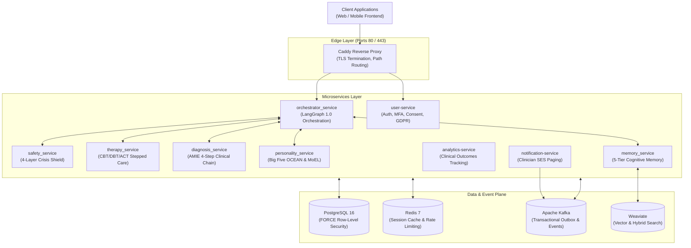

# 🌟 Solace-AI: Advanced Mental Health AI Companion Backend

[](https://www.python.org/)
[](https://fastapi.tiangolo.com/)
[](https://github.com/langchain-ai/langgraph)
[](https://www.postgresql.org/)
[](https://kafka.apache.org/)
[](https://www.docker.com/)
[](#-security-privacy--compliance)
[](LICENSE)

Solace-AI is an enterprise-grade backend platform designed to provide evidence-based, clinically grounded, and personalized digital mental health support. Built as a distributed microservice system orchestrated via LangGraph, Solace-AI adheres to strict clinical safety guardrails, continuous personality adaptation, multi-tier cognitive memory, and zero-trust PHI privacy standards.

---

## 📋 Table of Contents

- [🌟 Core Clinical Capabilities](#-core-clinical-capabilities)
- [🏗️ System Architecture](#️-system-architecture)
- [📂 Project Structure](#-project-structure)
- [🔧 Technology Stack](#-technology-stack)
- [🚀 Getting Started & Local Development](#-getting-started--local-development)
- [🧪 Testing & Quality Assurance](#-testing--quality-assurance)
- [🔄 CI/CD Pipelines](#-cicd-pipelines)
- [🛡️ Security, Privacy & Compliance](#️-security-privacy--compliance)
- [📖 Documentation Hub](#-documentation-hub)
- [⚠️ Clinical Disclaimer](#️-clinical-disclaimer)

---

## 🌟 Core Clinical Capabilities

- **Evidence-Based Interventions**: Dynamic therapeutic planning and delivery covering Cognitive Behavioral Therapy (CBT), Dialectical Behavior Therapy (DBT), Acceptance and Commitment Therapy (ACT), Motivational Interviewing (MI), and Mindfulness. Implements Stepped Care (Levels 0–4) tailored to validated screener outcomes (PHQ-9, GAD-7).
- **AMIE-Inspired Diagnostic Reasoning**: A 4-step Chain-of-Reasoning (*Analyze* $\rightarrow$ *Hypothesize* $\rightarrow$ *Challenge* $\rightarrow$ *Synthesize*) referencing DSM-5-TR and HiTOP dimensional models. Employs a dedicated **Devil's Advocate** agent to actively counter sycophancy and diagnostic confirmation bias.
- **Personality & Empathy Adaptation**: Real-time continuous Big Five (OCEAN) trait scoring combined with a Mixture of Empathetic Listeners (MoEL across 32 emotion states) to dynamically align communication style ($r > 0.85$).
- **5-Tier Cognitive Memory Hierarchy**: Seamless transition from working memory to long-term semantic context (*Input Buffer* $\rightarrow$ *Working Memory* [Redis] $\rightarrow$ *Session Memory* [Redis + PostgreSQL] $\rightarrow$ *Episodic Memory* [PostgreSQL + Weaviate] $\rightarrow$ *Semantic Memory*). Memory follows Ebbinghaus decay with a critical **safety override**: crisis disclosures and risk factors never decay.
- **Always-Active 4-Layer Crisis Shield**: Continuous risk screening mapped to the Columbia-Suicide Severity Rating Scale (C-SSRS). High and critical disclosures immediately provide verified local crisis resources (e.g., 988 Lifeline) bypassing generative LLM latency, alert on-call clinicians via Amazon SES, and commit durable records to a transactional outbox.

---

## 🏗️ System Architecture

Solace-AI is structured into 10 decoupled FastAPI microservices communicating via asynchronous Kafka event streams and REST/WebSocket APIs, with edge TLS terminated by Caddy.



---

## 📂 Project Structure

```
.
├── services/                        # FastAPI Microservices
│   ├── orchestrator_service/        # Multi-agent LangGraph workflow, REST & WS APIs
│   ├── safety_service/              # Crisis keyword matching, guardrails, contraindications
│   ├── therapy_service/             # Clinical unit selection, intervention planning
│   ├── diagnosis_service/           # Symptom extraction, differential assessment
│   ├── memory_service/              # Vector and episodic cognitive retrieval
│   ├── personality_service/         # OCEAN trait detection and style adaptation
│   ├── user-service/                # User accounts, OAuth (Google PKCE), JWT, MFA, GDPR erasure
│   ├── notification-service/        # Clinician paging, alert delivery, SES notifications
│   ├── analytics-service/           # Outcome measures tracking (PHQ-9, GAD-7, SRS)
│   ├── config_service/              # (Frozen under D-19)
│   └── shared/                      # Service-level shared modules
├── src/                             # Shared Foundation Packages
│   ├── solace_common/               # Core data models, schemas, shared interfaces
│   ├── solace_events/               # Kafka event schemas, transactional outbox contracts
│   ├── solace_infrastructure/       # IF-01 service runtime, ConnectionPoolManager, health probes
│   ├── solace_security/             # IF-04 Service tokens, AES-256-GCM PHI codec, RLS context
│   └── solace_testing/              # Test fixtures, mock providers, testcontainers harness
├── deploy/                          # Deployment Configuration
│   ├── env/                         # env-contract.yaml and strict environment schema readers
│   └── secrets/                     # SOPS + age encrypted secret templates
├── docker/                          # Base Docker files and database migration entrypoint
├── infrastructure/                  # Caddy reverse proxy, Prometheus, Grafana, init-db
├── migrations/                      # Alembic database migration chain (Slots 001–021)
├── scripts/                         # Maintenance, test runners, and DB tooling
│   ├── ci/                          # CI suite runner, image builder, clean checkout, secret scan
│   └── db/                          # Database migration runner and TLS certificate generator
├── system-design/                   # Detailed architectural specifications and diagrams
├── docs/                            # Documentation hub, API handoff, and MVP remediation plans
└── tests/                           # Complete test suite (unit, realinfra, security, e2e)
```

---

## 🔧 Technology Stack

| Layer | Component | Description |
|---|---|---|
| **Runtime & Framework** | Python 3.12, FastAPI, Uvicorn | Async microservices with Pydantic v2 validation. |
| **Agent Orchestration** | LangGraph 1.0, PostgreSQL Saver | Directed cyclic graph coordinating clinical and safety agents. |
| **Relational Storage** | PostgreSQL 16 | Enforced Row-Level Security (`FORCE RLS`) via unprivileged `solace_app` role. |
| **Event Streaming** | Apache Kafka | Event-driven microservice integration with a transactional outbox. |
| **Cache & Ephemeral Data**| Redis 7 | Sub-10ms session working memory, token revocation, rate limiting. |
| **Vector Database** | Weaviate | Hybrid BM25 and semantic vector search for long-term memory. |
| **Edge & Proxy** | Caddy v2 | Automatic HTTPS, TLS termination, internal port isolation. |
| **Secrets Management** | SOPS + age (D-07) | Version-controlled, zero-plaintext encrypted configuration. |
| **Package Management** | `uv` (Hash-Pinned) | Deterministic lockfiles (`requirements.lock`, `requirements-dev.lock`). |

---

## 🚀 Getting Started & Local Development

### 1. Prerequisites
- **Python 3.12**
- **Docker Engine & Docker Compose v2** (with at least 8 GB RAM allocated)
- **`uv` package manager**:
  ```bash
  pip install "uv==0.8.2"
  ```

### 2. Environment Setup
Create a local Python virtual environment and synchronize dependencies from the hash-pinned lockfile:
```bash
python -m venv .venv
source .venv/bin/activate  # On Windows: .venv\Scripts\Activate.ps1
uv pip sync --require-hashes requirements-dev.lock
```

Copy the development environment template:
```bash
cp .env.example .env
```

### 3. Start Data Plane & Services
Launch the backing infrastructure (Postgres, Redis, Kafka, Weaviate, and Caddy) with Docker Compose:
```bash
docker compose up -d
```

Apply database migrations:
```bash
make migrate
# or: python -m scripts.db.migrate upgrade head
```

Verify service health:
```bash
curl http://localhost:8000/health  # Orchestrator
curl http://localhost:8001/health  # User Service
curl http://localhost:8002/health  # Safety Service
```

---

## 🧪 Testing & Quality Assurance

Solace-AI enforces strict **Test-Driven Development (TDD)**. All suites run under process-level isolation to prevent cross-test contamination.

```bash
# Run unit test suites
make test-unit

# Run real-infrastructure tests (Postgres, Kafka, Weaviate testcontainers)
make test-realinfra

# Run on-demand End-to-End suite
make test-e2e PROFILE=dev

# Run repository secret scan (SOPS + age hygiene)
python scripts/ci/secret_scan.py

# Run critical lint check
make lint
```

---

## 🔄 CI/CD Pipelines

The repository features comprehensive automation powered by GitHub Actions:

- **Continuous Integration** ([.github/workflows/ci.yml](.github/workflows/ci.yml)):
  - **Dynamic Matrix Planning**: Discovers all 28+ test suites and 10 container images dynamically.
  - **Process-Isolated Execution**: Runs unit tests, real-infrastructure suites, and syntax checks concurrently.
  - **In-Container Module Probing**: Builds images from repository root context and verifies startup and import resolution inside the container.
  - **Fast Caching & Path Filtering**: Leverages `actions/cache@v4` on `~/.cache/uv` and skips runner dispatch on docs-only changes.
  - **On-Demand E2E**: End-to-end tests run on manual dispatch across `dev` or `strict` profiles.

- **Continuous Delivery** ([.github/workflows/cd.yml](.github/workflows/cd.yml)):
  - Triggers on release tags (`v*.*.*`) or manual deployment workflow dispatch.
  - Builds and publishes container images to **GitHub Container Registry (`ghcr.io`)** tagged with semantic release versions, commit SHAs, and `latest`.

---

## 🛡️ Security, Privacy & Compliance

- **Zero-Trust PHI Protection**: Personal Health Information (PHI) is encrypted at rest using AES-256-GCM via [phi_codec.py](src/solace_security/phi_codec.py) with user ID as Additional Authenticated Data (AAD).
- **PostgreSQL FORCE RLS**: All application queries connect as `solace_app` with Row-Level Security enforced. No user can read or modify another user's records. Work operates strictly within `acting_as_user(user_id)`.
- **Inter-Service Authentication (IF-04)**: Microservices communicate using short-lived cryptographically signed service tokens (`ServiceTokenManager`) with on-behalf-of (`obo`) claims. User credentials never enter LangGraph state.
- **Fail-Closed Strict Environments**: In `staging` or `production`, missing secrets, loopback database addresses, or unverified TLS connections immediately abort startup.

---

## 📖 Documentation Hub

- **[API Handoff & Frontend Guide](docs/API-HANDOFF.md)**: REST & WebSocket endpoints, Google OAuth PKCE flows, and message contracts.
- **[System Design Blueprint](system-design/README.md)**: In-depth technical specifications and Mermaid diagrams for all 5 core modules.
- **[Staging Bring-Up Runbook](docs/STAGING-BRINGUP.md)**: Instructions for deploying strict single-host staging and production stacks.
- **[MVP Remediation Hub](docs/mvp/README.md)**: Tracking hub for the MVP program, including decisions ([DECISIONS.md](docs/mvp/DECISIONS.md)), task tracker ([TRACKER.md](docs/mvp/TRACKER.md)), and open items ([OPEN-ITEMS.md](docs/mvp/OPEN-ITEMS.md)).

---

## ⚠️ Clinical Disclaimer

Solace-AI is designed as an AI-powered conversational support companion and mental health screening aid. **It is not an FDA-cleared medical device, nor a substitute for professional clinical diagnosis or medical care.** Individuals experiencing acute psychological distress or suicidal ideation are immediately routed to emergency services and crisis helplines (such as 988 Suicide & Crisis Lifeline).
