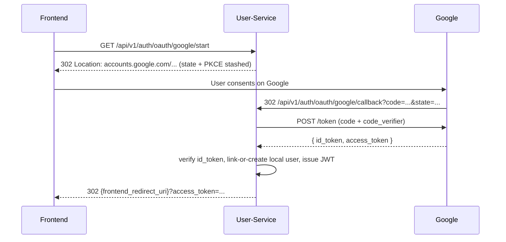

# Solace-AI API Handoff (for frontend team)

> ✅ **RECONCILED to the running code (2026-07-27, Phase B / REV-21).** The endpoint paths, WebSocket auth, response shape, and rate limits below now match what the services actually serve. Two items remain **not implemented** and are called out inline where they appear: **Google OAuth** (§2.2 — no endpoints exist yet; REV-22) and **server-side WS replay** on reconnect (§4 — the thread now resumes but the tail is not re-sent; REV-23). Do not integrate those two until they ship. Everything else is live.

> **Audience**: The web + mobile frontend repo (separate codebase).
> **Purpose**: Everything the frontend needs to integrate with the
> Solace-AI backend: base URLs, auth flows, endpoint list, WebSocket
> protocol, OAuth redirect contract, and demo credentials.

---

## 1. Base URLs

| Environment | Base URL |
|------------|----------|
| Local dev (docker-compose) | `http://localhost:8000` (orchestrator) |
| Auth endpoints (local) | `http://localhost:8001` (user-service) |
| Production (VPS) | `https://api.{your-domain}` (Caddy-routed) |
| Auth (production) | `https://auth.{your-domain}` |

Caddy terminates TLS; every internal service is reached via the
domain-based routing in [`Caddyfile`](../Caddyfile).

---

## 2. Authentication flows

### 2.1 Email + password (default)

```
POST /api/v1/auth/register          -> 201 { user_id, email }
POST /api/v1/auth/login              -> 200 { access_token, refresh_token }
POST /api/v1/auth/refresh            -> 200 { access_token, refresh_token }
POST /api/v1/auth/logout             -> 204
```

All subsequent calls authenticate via `Authorization: Bearer <access_token>`.

### 2.2 Google OAuth2 — ⚠️ NOT IMPLEMENTED (deferred, REV-22)

> **Do not integrate yet.** The `/api/v1/auth/oauth/google/start|callback`
> endpoints described below **do not exist** in the running user-service —
> only helper functions exist, and the id_token is currently decoded
> **without signature verification**. This section documents the *intended*
> contract; it is tracked as REV-22 and will be enabled (with real JWKS
> id_token verification) in sprint B.3. Use email + password (§2.1) for now.

Intended three-leg OAuth with PKCE (RFC 7636). The frontend redirects the
browser to the `/start` endpoint, which 302s to the Google consent screen.



- **Redirect URI** (register with Google Cloud Console):
  `https://auth.{domain}/api/v1/auth/oauth/google/callback`
- **State nonce** + **PKCE code_verifier** are retained in a signed
  short-lived cookie on the user-service; the frontend does not need
  to manage them.
- **Apple Sign In**: deferred post-MVP (per product decision to avoid
  the $99/yr Apple Developer enrollment for the demo).

---

## 3. Core endpoints

> Every service exposes Swagger/OpenAPI at `{service_base}/docs`. Use
> those as the authoritative reference. The table below is a survey.

| Service | Endpoint | Method | Purpose |
|---------|----------|--------|---------|
| Orchestrator | `/api/v1/orchestrator/chat` | POST | Main chat message send |
| Orchestrator | `/api/v1/orchestrator/sessions` | POST | Create a conversation session |
| Orchestrator | `/api/v1/orchestrator/sessions/{session_id}/history` | GET | Conversation history (owner-only) |
| Orchestrator | `/api/v1/orchestrator/ws/{session_id}` | WS | Streaming chat (JWT via `?token=` query param) |
| Orchestrator | `/api/v1/orchestrator/agents` | GET | List available agents |
| User | `/api/v1/users/me` | GET/PUT | Current user profile |
| User | `/api/v1/users/me/consent` | GET/POST | Consent records |
| User | `/api/v1/auth/revoke-token` | POST | Revoke a token (blacklist) |
| Safety | `/api/v1/safety/check` | POST | Run safety check (`check_type=full_assessment`) |
| Safety | `/api/v1/safety/resources` | GET | Crisis resources per level |
| Diagnosis | `/api/v1/diagnosis/assess` | POST | 4-step assessment |
| Diagnosis | `/api/v1/diagnosis/sessions/{id}` | GET | Session state |
| Therapy | `/api/v1/therapy/sessions` | POST | Start session |
| Therapy | `/api/v1/therapy/sessions/{id}/message` | POST | Send message in session |
| Memory | `/api/v1/memory/context` | POST | Retrieve context for user |
| Personality | `/api/v1/personality/detect` | POST | OCEAN trait detection |
| Personality | `/api/v1/personality/style` | POST | Style adaptation |
| Health | `/health`, `/ready`, `/live` | GET | Standard health probes |

---

## 4. WebSocket protocol

Endpoint: `wss://api.{domain}/api/v1/orchestrator/ws/{session_id}`

Authenticated via a **`token` query parameter** on the handshake URL —
`.../ws/{session_id}?token=<access_token>` — not an `Authorization`
header (browsers cannot set headers on the WebSocket handshake). The
token is validated with a revocation-aware check, so a logged-out/revoked
token is rejected at connect time.

### Message schema (client → server)

```json
{
  "type": "chat.message",
  "session_id": "uuid",
  "content": "string",
  "metadata": { "client_ts": "ISO-8601" }
}
```

### Message schema (server → client)

```json
{
  "type": "chat.response.delta" | "chat.response.final" |
          "safety.alert" | "session.phase_changed" | "error",
  "session_id": "uuid",
  "content": "string",              // for delta / final
  "crisis_level": "HIGH",          // for safety.alert
  "resources": [{ "name": "988 Lifeline", ... }],  // for safety.alert
  "phase": "WORKING",              // for session.phase_changed
  "code": "auth_required",         // for error
  "message": "Please re-authenticate"
}
```

### Reconnection

- On unexpected close, reconnect with exponential backoff (1s, 2s, 4s,
  8s, cap at 30s) to the **same `session_id`**. The server keys the
  LangGraph conversation thread on `(user_id, session_id)`, so
  reconnecting to the same session **resumes the same conversation
  context** (no lost history/state).
- Re-auth with a fresh access token if the refresh token has expired.
- ⚠️ **Server-side replay of the message tail is NOT yet implemented
  (REV-23).** Resuming restores conversation *context*, but any message
  that was in-flight across the disconnect is not re-sent by the server —
  the client must resend un-acked messages. Full replay is a B.3 item.

---

## 5. Response shape

> ⚠️ There is **no `{status, data, meta}` envelope** on success responses
> (an earlier version of this doc claimed one; it was never applied). A
> successful call returns the endpoint's model **directly** — e.g. `POST
> /api/v1/orchestrator/chat` returns a `ChatMessageResponse` object at the
> top level. Correlation is carried in **response headers**
> (`X-Request-ID`, `X-Correlation-ID`, `X-Process-Time-Ms`), not a `meta`
> block.

**Errors** are returned as:

```json
{
  "error": {
    "code": "VALIDATION_ERROR",
    "message": "Request validation failed",
    "details": [ { "field": "message", "message": "...", "type": "..." } ]
  }
}
```

(`details` is present for 422 validation errors.) Error codes:
`VALIDATION_ERROR`, `BAD_REQUEST`, `RATE_LIMIT_EXCEEDED`, `INTERNAL_ERROR`,
plus the domain codes `AUTHENTICATION_ERROR`, `AUTHORIZATION_ERROR`,
`SAFETY_ERROR`, `INFRASTRUCTURE_ERROR`, `LLM_SERVICE_ERROR` defined in
[`src/solace_common/exceptions.py`](../src/solace_common/exceptions.py).

---

## 6. Rate limits

| Scope | Limit | Status |
|------|-------|--------|
| Per-authenticated-user (orchestrator HTTP) | 60/min | ✅ enforced (app middleware) |
| Global (orchestrator HTTP) | 1000/min | ✅ enforced (app middleware) |
| Anonymous / per-IP fallback | shares the above, keyed on `X-Forwarded-For`/client IP | ✅ enforced |
| Per-session WS message rate | — | 🟡 not yet (B.3) |
| Edge per-IP (Caddy directive) | 1000/min | 🟡 not yet (B.3) |

Limits are enforced in-process by the orchestrator's rate-limit
middleware (disabled only under `ENVIRONMENT=test`). Every response
carries `X-RateLimit-Limit` / `X-RateLimit-Remaining` / `X-RateLimit-Reset`;
a **429** response additionally includes a `Retry-After` header (seconds)
and body `{"error": {"code": "RATE_LIMIT_EXCEEDED", ...}}`. Multi-instance
(Redis-backed) enforcement lands with staging in B.3.

---

## 7. CORS

Production allows only `https://{your-frontend-domain}`. For local
dev set `CORS_ALLOWED_ORIGINS=http://localhost:3000` in `.env`.

---

## 8. Required frontend env vars

```
NEXT_PUBLIC_API_BASE_URL=https://api.{domain}
NEXT_PUBLIC_AUTH_BASE_URL=https://auth.{domain}
# WS: append /{session_id}?token=<access_token> at connect time
NEXT_PUBLIC_WS_URL=wss://api.{domain}/api/v1/orchestrator/ws
# NEXT_PUBLIC_GOOGLE_OAUTH_START — deferred until OAuth ships (REV-22); do not wire yet
```

---

## 9. OpenAPI specs

Each service exports an OpenAPI 3.x spec at `/openapi.json`. Download
them via:

```bash
for svc in 8000 8001 8002 8003 8004 8005 8006 8007 8008 8009; do
    curl -fsS https://api.{domain}/openapi-${svc}.json > docs/api-specs/${svc}.json
done
```

Or in local dev: `curl -fsS http://localhost:${port}/openapi.json`.

---

## 10. Reviewer / demo account

Seed script [`scripts/seed_demo_data.py`](../scripts/seed_demo_data.py)
(to be added as part of final deployment) creates:

- 1 clinician-reviewer account with an elevated role
- 3 synthetic personas (Sarah high-N, Marcus high-C, Elena high-O)
- 4 DSM-5-TR training-vignette personas
- 3 Kaplan & Sadock composite personas

Credentials are logged to `docs/DEMO-DATA.md` when the script runs.
